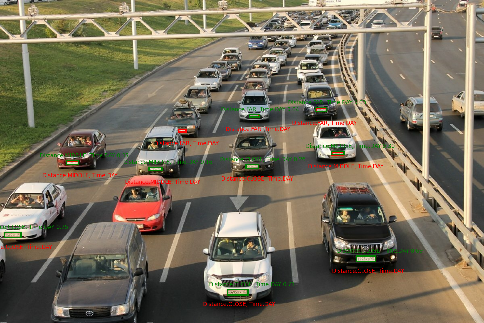

<div align="center">

<h1>
  <br>
  🅿🅻🅰🆃🅴🆂🅲🅰🅽🅽🅴🆁
  <br>
</h1>

<h3>License-plate detection and recognition</h3>

<p><i>Five detector architectures, three OCR models and a validation method that looks past a single mAP number.</i></p>

<p>
  
  
  
  
  
  
</p>

<p>
  <a href="#tldr">TL;DR</a> •
  <a href="#quickstart">Quickstart</a> •
  <a href="#modes">Modes</a> •
  <a href="#results">Results</a> •
  <a href="#validation">Validation method</a> •
  <a href="#tech-stack">Tech stack</a> •
  <a href="#license">License</a>
</p>

<a href="https://huggingface.co/spaces/PavelLekomtsev/PlateScanner">Demo on Hugging Face</a>

</div>

---

<div align="center">
  
  <br><sub><i>Plates detected on a dense traffic scene; every box is passed to the recognition model.</i></sub>
</div>

---

<a id="tldr"></a>
## 🚀 TL;DR

PlateScanner finds Russian vehicle license plates on images and reads them. It is a command-line tool built by the [Encore Ecosystem](https://github.com/encore-ecosystem) team:

- **Detection** – Ultralytics YOLO models, including oriented bounding boxes (OBB) for tilted plates. Five architectures were trained and compared; YOLO11x gives the best balance (precision 0.95, recall 0.73 at confidence 0.06).
- **Recognition (OCR)** – three text-recognition models were tested; ParseQ wins with a mean average Levenshtein similarity of 0.935.
- **Validation** – on top of mAP50 / mAP50-95, ground-truth boxes are split by distance to the camera, time of day and brightness, so a model that only sees far-away plates no longer looks as good as one that generalises.

---

<a id="quickstart"></a>
## ⚡ Quickstart

Needs Python 3.12. Dependencies are managed with Poetry; PyTorch comes from the CUDA 12.4 wheel index.

```bash
git clone https://github.com/encore-ecosystem/PlateScanner.git
cd PlateScanner
poetry install                     # or: pip install . --extra-index-url https://download.pytorch.org/whl/cu124
export PLATESCANNER_ROOT_PATH="$PWD"   # Windows: set PLATESCANNER_ROOT_PATH=%cd%
platescanner help
```

Run detection and recognition on a folder of images (the output folder must exist and be empty; the confidence level is given in percent):

```bash
platescanner predict -weights_path models/yolo11n-obb.pt -dataset_path path/to/images -output_path path/to/output -confidence_level 6
```

<a id="modes"></a>
### Modes

| Mode | What it does | Main flags |
|---|---|---|
| `train` | trains a detector, optionally logging to ClearML | `-weights_path`, `-dataset_path`, `-use_clearml` |
| `predict` | detection, or detection + recognition | `-weights_path`, `-dataset_path`, `-output_path`, `-confidence_level`, `-detection_only` |
| `validate` | detection and/or recognition metrics on a labelled set | `-weights_path`, `-dataset_path`, `-output_path`, `-confidence_level`, `-detection_only` |
| `find_confidence` | searches for the confidence threshold that reaches a target precision | `-weights_path`, `-dataset_path`, `-iters`, `-target_precision` |
| `make_calibration_dataset` | builds a calibration set from a dataset | `-dataset_path` |

---

<a id="results"></a>
## 📊 Results

**Detection** – target set of 24 varied images, confidence fixed at 0.06:

| Model | TP | FN | FP | Precision | Recall | F1 | Time, s / frame |
|---|---:|---:|---:|---:|---:|---:|---:|
| yolo11n-obb | 18 | 57 | 4 | 0.818 | 0.240 | 0.371 | 0.448 |
| yolov5nu | 40 | 35 | 20 | 0.667 | 0.533 | 0.593 | 0.187 |
| yolo11n | 46 | 29 | 5 | 0.902 | 0.613 | 0.730 | 0.453 |
| yolo11n-obb v2 | 56 | 19 | 21 | 0.727 | 0.747 | 0.737 | 0.206 |
| **yolo11x** | 55 | 20 | 3 | **0.948** | 0.733 | **0.827** | 0.658 |

**Detection at precision > 0.90** – confidence tuned per model with `find_confidence`:

| Model | Confidence | TP | FN | FP | Precision | Recall | F1 |
|---|---:|---:|---:|---:|---:|---:|---:|
| yolo11n-obb | 0.43 | 10 | 65 | 1 | 0.909 | 0.133 | 0.233 |
| yolov5nu | 0.27 | 28 | 47 | 1 | 0.966 | 0.373 | 0.539 |
| yolo11n-obb v2 | 0.54 | 35 | 40 | 2 | 0.946 | 0.467 | 0.625 |
| yolo11n | 0.14 | 43 | 32 | 3 | 0.935 | 0.573 | 0.711 |
| **yolo11x** | 0.07 | 55 | 20 | 2 | **0.965** | 0.733 | **0.833** |

**Recognition (ParseQ):**

| Metric | Value | Meaning |
|---|---:|---|
| Mean average Levenshtein similarity | 0.935 | missing, extra and wrong characters are penalised equally; averaged per image, then over the set |
| Business metric | 0.800 | share of plates read exactly right |

---

<a id="validation"></a>
## 🔍 Validation method

A single mAP hides the cases that matter in production: one of our networks was excellent on distant plates and missed close ones, another found many plates but read them worse. PlateScanner therefore classifies every ground-truth box by **distance** (box size), **time of day** and **brightness**, and reports detection quality per group on top of the standard mAP50 and mAP50-95.

The full write-up (in Russian) is in [appendices/articles/Art1.md](appendices/articles/Art1.md).

---

<a id="tech-stack"></a>
## 🧰 Tech stack

| Area | Tools |
|---|---|
| Detection | Ultralytics YOLO11 / YOLOv5, OBB heads, custom NMS and area filters |
| Recognition | ParseQ (PyTorch Lightning, timm) |
| Data | Albumentations, pycocotools, Shapely, CVTK (YOLO ↔ COCO conversion) |
| Experiments | ClearML, NodeFlow pipelines |
| Packaging | Poetry, `platescanner` console script |

Authors: Maksim Shushkevich, Pavel Lekomtsev, Vladislav Tyurin – Encore Ecosystem.

---

<a id="license"></a>
## 📜 License

Distributed under the PlateScanner End-User License Agreement – see [LICENSE](LICENSE).
